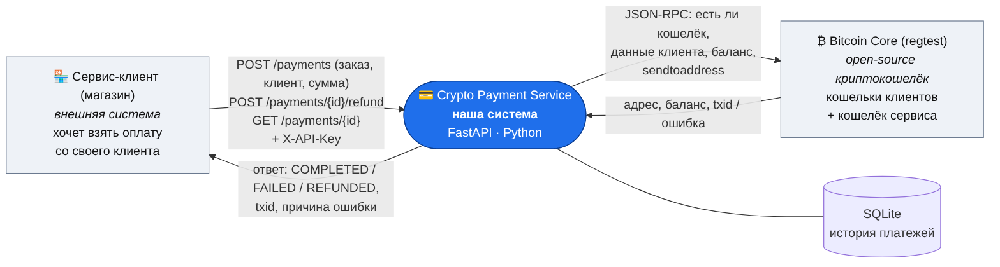
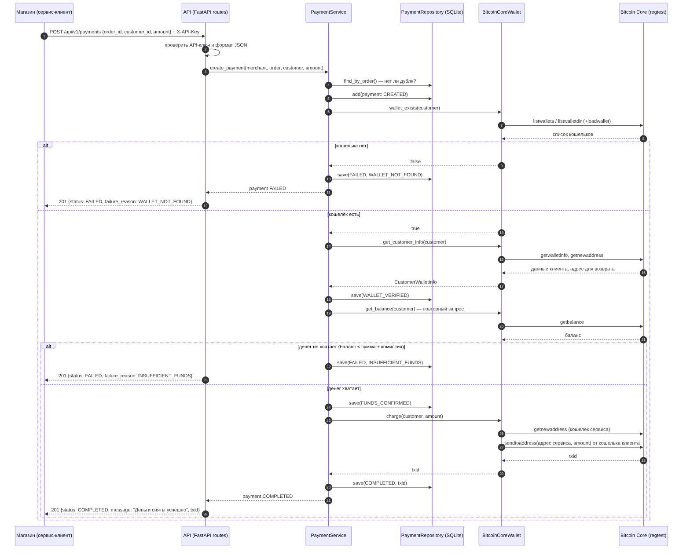
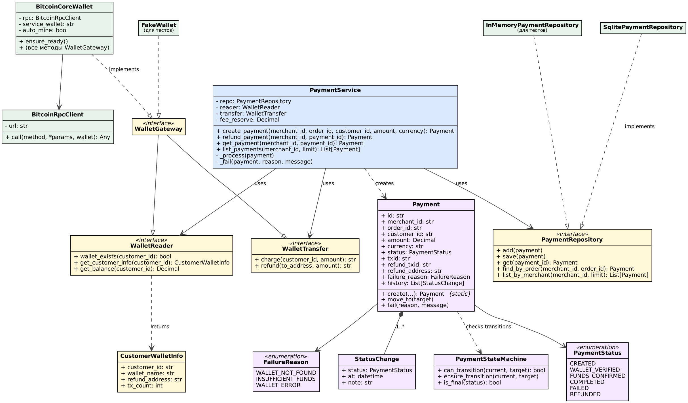
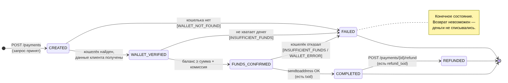

# Диаграммы

Исходники лежат рядом в `docs/diagrams/`: Mermaid (`.mmd`) и Graphviz (`.dot`). Их можно править и перерисовывать (см. конец файла).

## 1. Контекстная диаграмма (Context)

Показывает систему целиком как «чёрный ящик» и её окружение: кто к ней обращается и к чему обращается она сама.



- **Сервис-клиент (магазин)** отправляет запросы по REST API с ключом `X-API-Key`.
- **Bitcoin Core** — внешний open-source кошелёк, с ним сервис общается по JSON-RPC.
- **SQLite** — собственное хранилище сервиса, поэтому находится внутри его границы.

## 2. Диаграмма последовательности (Sequence)

Порядок вызовов в сценарии «оплата» со всеми ветками: кошелька нет, денег не хватает, успех.



## 3. Диаграмма классов (Class)



Как читать:
- **Жёлтые** — интерфейсы (порты): `WalletReader`, `WalletTransfer`, `WalletGateway`, `PaymentRepository`.
- **Зелёные** — их реализации (адаптеры): Bitcoin Core, SQLite и тестовые подделки.
- **Голубой** — бизнес-логика: `PaymentService`.
- **Фиолетовые** — доменная модель: `Payment`, статусы, машина состояний.
- Пунктир с пустым треугольником означает «реализует интерфейс». Сплошная линия с треугольником означает «наследует».

## 4. Диаграмма состояний (State) запроса на оплату



| Из | В | Когда |
|---|---|---|
| — | CREATED | пришёл запрос `POST /payments` |
| CREATED | WALLET_VERIFIED | кошелёк найден, данные клиента получены |
| CREATED | FAILED | кошелька нет (`WALLET_NOT_FOUND`) |
| WALLET_VERIFIED | FUNDS_CONFIRMED | денег хватает |
| WALLET_VERIFIED | FAILED | денег не хватает (`INSUFFICIENT_FUNDS`) |
| FUNDS_CONFIRMED | COMPLETED | перевод прошёл, есть `txid` |
| FUNDS_CONFIRMED | FAILED | кошелёк отказал при переводе |
| COMPLETED | REFUNDED | магазин запросил возврат |

`FAILED` и `REFUNDED` — конечные состояния. В коде эти правила записаны в `app/domain/state_machine.py`.

## Как перерисовать

```bash
npm i -g @mermaid-js/mermaid-cli          # один раз
mmdc -i docs/diagrams/1_context.mmd  -o docs/diagrams/1_context.png  -b white -s 2
mmdc -i docs/diagrams/2_sequence.mmd -o docs/diagrams/2_sequence.png -b white -s 2
mmdc -i docs/diagrams/4_state.mmd    -o docs/diagrams/4_state.png    -b white -s 2
dot -Tpng -Gdpi=130 docs/diagrams/3_class.dot -o docs/diagrams/3_class.png   # Graphviz
```

Mermaid-файлы можно открыть и без установки: вставьте их текст на https://mermaid.live
